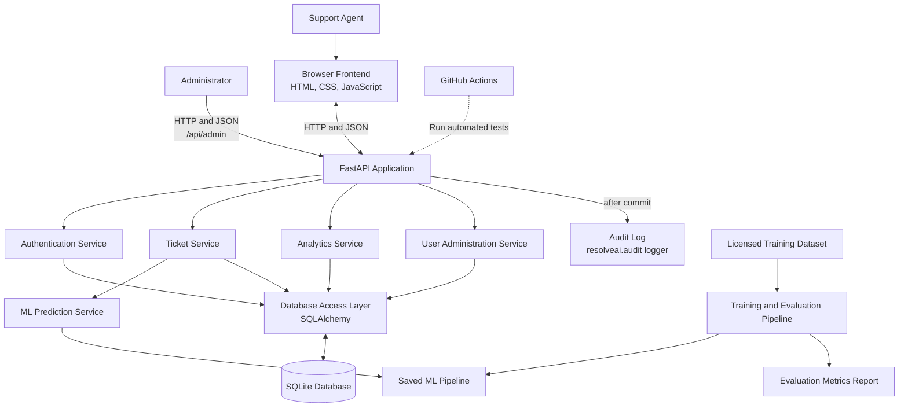

# ResolveAI — System Architecture

**Version:** 1.0
**Status:** Initial architecture
**Architecture style:** Modular monolith

## 1. Overview

ResolveAI is a web application for managing customer support tickets and suggesting ticket categories using machine learning.

The application will use a modular monolithic architecture. The frontend, backend API, business logic and ML prediction service will be organised into separate modules within one Python application.

The first version will run locally on Windows and use SQLite. No paid AI API or external inference service is required.

## 2. Architecture diagram



The browser will access the frontend and REST API through the FastAPI application. This same-origin arrangement keeps the initial local setup straightforward.

The ML training workflow will run separately from the web application's normal startup.

## 3. Technology stack

| Layer | Technology | Responsibility |
|---|---|---|
| Frontend | HTML, CSS, JavaScript, Bootstrap | Forms, ticket lists, filters and dashboard |
| Backend | Python and FastAPI | HTTP requests, API endpoints and validation |
| Request schemas | Pydantic | Validate API input and output |
| Database | SQLite | Store users and tickets |
| ORM | SQLAlchemy | Map Python objects to relational tables |
| ML processing | pandas and NumPy | Prepare and inspect training data |
| ML model | scikit-learn | TF-IDF text features and Logistic Regression |
| Model artifact | joblib | Save and load the trusted trained pipeline |
| Testing | pytest | Test application behaviour |
| CI | GitHub Actions | Run automated checks |
| Version control | Git and GitHub | Track and review changes |

## 4. Application modules

### 4.1 Frontend

Location: `frontend/`

The frontend will provide:

- Login screen
- Ticket dashboard
- Ticket creation form
- Ticket list with search and filters
- Ticket detail and edit view
- ML prediction and confidence display
- Model evaluation summary

JavaScript will call the backend using HTTP requests and process JSON responses.

### 4.2 API layer

Location: `app/api/routes/`

The API layer will receive HTTP requests, validate input, invoke the appropriate service and return structured responses.

Planned API groups:

- Authentication
- Tickets
- Analytics
- Administration: user management, admin only (implemented in `app/api/routes/admin.py`; see [section 14](#14-admin-user-management))
- ML predictions and evaluation metrics

Interactive API documentation will be available through FastAPI's development documentation page.

### 4.3 Business services

Location: `app/services/`

The service layer will contain application rules rather than putting all logic inside API routes.

Planned services:

- Authentication and user access
- Ticket creation and updates
- Ticket search and filtering
- Dashboard aggregation
- User administration: account creation, listing, role and status changes (`app/services/user_service.py`)

### 4.4 Database layer

Locations: `app/db/` and `app/models/`

SQLAlchemy will manage database interactions.

The schema is versioned with Alembic migrations (`alembic/versions/`). See [database-migrations.md](database-migrations.md) for setup and upgrade procedures.

The first version will use SQLite. Database access will be separated from business logic so the project can be adapted to PostgreSQL later.

### 4.5 Machine-learning module

Location: `app/ml/`

The prediction module will load a saved scikit-learn pipeline and receive ticket text.

The pipeline will transform the text using TF-IDF and predict a ticket category using Logistic Regression.

It will return:

- Predicted category
- Model confidence estimate
- Prediction status

The module will not retrain the model when a ticket is created.

Training code and evaluation code will live separately under `ml/`.

## 5. Ticket creation workflow

1. A support agent submits a ticket from the frontend.
2. FastAPI validates the request.
3. The ticket service sends the title and description to the prediction module.
4. The prediction module returns a category suggestion and confidence estimate.
5. The ticket service stores the ticket and prediction details in SQLite.
6. The API returns the saved ticket to the frontend.
7. The frontend displays the ticket and its suggested category.
8. The support agent may correct the final category or update the priority and status.

If prediction fails, the application must still allow the ticket to be recorded. The prediction fields can remain empty, and the ticket must be marked as needing category review.

## 6. Database design

### 6.1 Users

The `users` table will contain:

- `id`: Primary key
- `name`: Display name
- `email`: Unique login identifier
- `password_hash`: Secure password hash
- `role`: Authorised application role: `admin`, `agent` or `customer`
- `is_active`: Whether the account may authenticate
- `token_version`: Session version embedded in every access token; incrementing it invalidates all previously issued tokens for the user
- `created_at`: Account creation timestamp

Passwords must never be stored in plain text.

### 6.2 Tickets

The `tickets` table will contain:

- `id`: Primary key
- `title`: Ticket title
- `description`: Ticket description
- `requester_name`: Optional requester name
- `predicted_category`: Original ML category suggestion
- `prediction_confidence`: Model confidence estimate
- `category`: Final category, which may be empty until reviewed
- `priority`: Low, Medium or High
- `status`: Open, In Progress or Resolved
- `created_by_user_id`: Foreign key referencing `users.id`
- `created_at`: Ticket creation timestamp
- `updated_at`: Last update timestamp

The original prediction and final category must remain separate so human corrections do not erase the model's original output.

The application must handle tickets that have not yet received a valid prediction or final category.

## 7. API contract

| Method | Endpoint | Purpose |
|---|---|---|
| GET | `/api/health` | Application health check |
| POST | `/api/auth/login` | Authenticate a user |
| POST | `/api/auth/logout` | End the user session |
| GET | `/api/auth/me` | Return the current user |
| POST | `/api/tickets` | Create a ticket |
| GET | `/api/tickets` | List and filter tickets |
| GET | `/api/tickets/{id}` | Retrieve a ticket |
| PATCH | `/api/tickets/{id}` | Update ticket fields |
| GET | `/api/analytics/summary` | Retrieve dashboard statistics |
| GET | `/api/admin/users` | List, search and filter users (admin only) |
| GET | `/api/admin/users/{user_id}` | Retrieve a user (admin only) |
| POST | `/api/admin/users` | Create a user (admin only) |
| PATCH | `/api/admin/users/{user_id}/role` | Change a user's role (admin only) |
| PATCH | `/api/admin/users/{user_id}/status` | Activate or deactivate a user (admin only) |
| POST | `/api/ml/predict` | Test an ML prediction |
| GET | `/api/ml/metrics` | Retrieve the saved evaluation report |

All protected endpoints must enforce authentication and appropriate access permissions.

The final request and response schemas will be specified during implementation. The admin user-management endpoints are implemented; their request, response and error contract is documented in the [README](../README.md#admin-user-management).

## 8. Machine-learning workflow

The model-development workflow will be separate from the web application.

1. Obtain the documented customer-service dataset.
2. Inspect the dataset structure, category labels and licence.
3. Clean and validate the text and labels.
4. Define and document the mapping from source labels to ResolveAI categories.
5. Split the data into training, validation and test sets.
6. Train a TF-IDF and Logistic Regression baseline.
7. Evaluate the model using accuracy, macro-F1, precision, recall and a confusion matrix.
8. Save the approved pipeline and evaluation report.
9. Load the saved pipeline in the application.
10. Record predictions and allow support agents to correct them.

Test data must not be used to train the model or select its settings.

Reported metrics must come from actual evaluation results. Confidence estimates must not be presented as guarantees of correctness.

## 9. Error handling and security

- Validate required input fields and supported status, priority and category values.
- Return understandable HTTP error responses for invalid requests.
- Handle prediction failures without losing the ticket.
- Store password hashes, never plain-text passwords.
- Keep secret keys and local configuration out of source control.
- Enforce authentication on protected API routes.
- Apply appropriate authorisation checks to ticket operations.
- Avoid logging passwords, secret tokens or unnecessary personal information.
- Use only trusted model artifacts created by the project's training workflow.
- Use production security settings before any public deployment.
- Return `401` when authentication fails and `403` when an authenticated user's role is not permitted; decide authorisation before validating request bodies.
- Never return password hashes or `token_version` in API responses, and never echo submitted values in validation errors on the admin API.
- Record administrative actions with IDs, action names and role/status values only (see [section 14.6](#146-audit-logging)).

## 10. Testing strategy

Automated tests will cover:

- Application health checks
- Request validation
- Ticket creation and retrieval
- Ticket updates and category correction
- Database behaviour
- Authentication and access control
- Search and filtering
- Analytics calculations
- Prediction service behaviour
- Error handling when the model is unavailable

The same automated test suite should run locally and through GitHub Actions.

## 11. Repository structure

```text
resolveai-support-ticket-system/
├── app/
│   ├── main.py
│   ├── api/
│   │   └── routes/
│   ├── core/
│   ├── db/
│   ├── models/
│   ├── schemas/
│   ├── services/
│   └── ml/
│       └── predictor.py
├── frontend/
│   ├── index.html
│   ├── tickets.html
│   ├── ticket-detail.html
│   ├── css/
│   └── js/
├── ml/
│   ├── train.py
│   └── evaluate.py
├── tests/
├── docs/
│   ├── requirements.md
│   └── architecture.md
├── .github/
│   └── workflows/
├── .env.example
├── .gitignore
├── README.md
└── requirements.txt
```

The directory structure will be introduced progressively. Local datasets, database files, secrets, virtual environments and other generated files will be excluded from Git as appropriate.

## 12. Development and deployment

Local development will be the primary environment.

The first version will use SQLite and a CPU-compatible model, without requiring a paid API or cloud account.

Deployment will be considered only after the application, tests and documentation are working locally. Any external hosting option will be evaluated against its current free-tier limits and security requirements.

## 13. Architecture decisions to validate

Before implementation is complete, we must verify:

- The training dataset's licence and permitted uses.
- The actual source labels and the final category mapping.
- Compatibility between the chosen Python version and package versions.
- The authentication and session strategy.
- Database migration requirements. (Resolved: Alembic, with a baseline revision for pre-existing databases.)
- How the trained model and evaluation report will be generated from a fresh clone.
- The security configuration required for any public deployment.
- Concurrency of protected admin changes on PostgreSQL. Row locking is implemented but has only been checked by compiling the SQL, not under concurrent load on a live PostgreSQL server (see [section 14.4](#144-postgresql-and-other-databases)).
- Whether a persistent, database-backed audit trail is required in addition to the audit log stream.

## 14. Admin user management

Administrators manage accounts through the admin-only API in
`app/api/routes/admin.py` (mounted at `/api/admin`). The route module maps
service outcomes to HTTP responses and writes the audit log. The rules and
transactions live in `app/services/user_service.py`. The HTTP contract
(parameters, bodies, status codes, examples) is documented in the
[README](../README.md#admin-user-management).

### 14.1 Roles and request authorisation

The three roles are defined in `app/core/roles.py` (`UserRole`): `admin`,
`agent` and `customer`.

1. `get_current_user` (`app/api/dependencies.py`) decodes the JWT and loads
   the user from the database. A missing or invalid token, a revoked token,
   an inactive account or a `token_version` that differs from the stored one
   gives `401`.
2. `require_admin` (`require_roles(UserRole.ADMIN)`) gives `403` unless the
   stored role is exactly `admin`. Unknown stored roles are denied.
3. The admin router declares `require_admin` as a router-wide dependency, and
   each endpoint declares it as well (FastAPI evaluates it once per request).
   Dependencies run before body validation, so non-administrators receive
   `403`, never `422`.

The role is never read from the token; it is loaded from the database on
every request. This is why a role change takes effect immediately for tokens
the user already holds, without incrementing `token_version`.

### 14.2 Session invalidation

A status change (deactivation **or** reactivation) writes `is_active` and then
increments `token_version` with an atomic SQL `UPDATE`
(`invalidate_user_sessions(commit=False)`). Both changes are committed
together, so every token issued before the change is rejected afterwards, and
tokens issued before a deactivation never become valid again after
reactivation. Requesting the status the account already has writes nothing
and does not increment `token_version`.

Users are not deleted through the API. Deactivation keeps rows that reference
the user (for example `tickets.created_by_user_id`) intact, and it can be
reversed.

### 14.3 Serialised protected changes (SQLite)

Three operations are protected: account creation, role change and status
change. Each must check, inside one transaction that no other protected
change can interleave with:

- that the change does not remove the last **active** administrator (role
  `admin` and `is_active` true), for role and status changes;
- that the acting administrator is still an active administrator (actor
  revalidation). The request was authorised before the transaction started,
  and a concurrent request may have demoted or deactivated the actor since
  then.

Counting and then updating separately is not enough. Two administrators
deactivating each other at the same moment could each see two active
administrators and both succeed.

On SQLite, `SELECT ... FOR UPDATE` is not available, and the pysqlite driver
does not open a transaction until the first write. Each protected change
therefore begins with `BEGIN IMMEDIATE` (`_begin_serialised_change`), which
takes SQLite's single write lock **before** anything is read. The transaction
then:

1. reads the IDs of the active administrators, then reloads the target row
   (or, for creation, the actor's row), overwriting any stale copy loaded
   during authorisation;
2. applies the checks;
3. writes and commits, or rolls back on any failure. The commit also happens
   for a no-op, to release the lock.

A concurrent protected change waits for the lock up to the connection's
busy timeout. The application does not set one, so the Python `sqlite3`
default of 5 seconds applies. If the lock is not released in time, the change
fails with a safe `500` and writes nothing. A protected change refuses to run
in a session that has already written in its current transaction
(`TransactionAlreadyStartedError`), because `BEGIN IMMEDIATE` cannot be
issued there. That is a programming error, never a client error.

The self-modification check (`409`) happens before the transaction starts,
because it needs no database state.

**Account creation** (`create_user_as_admin`) performs actor revalidation,
insertion and commit in the same protected transaction:

1. `BEGIN IMMEDIATE`; reload the actor's row. The actor must exist, be active
   and have exactly the role `admin`, otherwise `403` and nothing is written.
2. `create_user(..., commit=False)` validates and normalises the fields,
   checks for a duplicate email (case-insensitive), hashes the password and
   inserts the row.
3. Commit.

**Trade-off: password hashing under the write lock.** Step 2 hashes the
password while the SQLite write lock is held, so other writes (including
other protected changes) wait for the duration of one hash. This is
intentional: it keeps revalidation and insertion atomic, so an administrator
whose access is removed concurrently cannot still create an account. The
password length (12 to 128 characters) is validated before the request
reaches the service, which bounds the hashing cost.

### 14.4 PostgreSQL and other databases

On databases with row locks, no `BEGIN IMMEDIATE` is issued. Instead the reads
in step 1 use `SELECT ... FOR UPDATE`: first every active administrator row,
in `id` order so that two changes cannot deadlock, then the target or actor
row. A concurrent change blocks until the first commits and then re-reads the
locked rows.

**Status:** this has been verified only by checking the compiled SQL for the
PostgreSQL dialect. Concurrency has **not** been tested against a live
PostgreSQL server, and PostgreSQL is not yet a supported production database.
In addition, recognising a duplicate email from the database's unique index
(the case where two requests create the same email at the same moment) is
implemented for SQLite's error only. Duplicates that already exist are found
by a lookup before the insert on any database.

### 14.5 Error handling

- Expected outcomes map to fixed messages: `404` (user not found), `409`
  (duplicate email, self-modification, last active administrator), `403`
  (actor no longer an administrator).
- The admin routes use a route class (`AdminRoute`) that removes submitted
  values (`input`) from `422` validation errors, so passwords and smuggled
  fields such as `password_hash` are never echoed back. The request models
  also forbid extra fields.
- Unexpected database errors reach the application's `SQLAlchemyError`
  handler: the client receives `500 {"detail": "Internal server error."}`
  and the server logs a short sanitised diagnostic without SQL, parameters or
  a traceback. If a rollback also fails, the original error is reported and
  the rollback failure is attached as a secondary failure.

### 14.6 Audit logging

`app/core/audit_logging.py` provides the dedicated `resolveai.audit` logger.
The route module calls `log_admin_action` only after the change has committed,
and only when something actually changed. Records contain the action
(`user.create`, `user.role_change`, `user.activate`, `user.deactivate`),
`actor_id`, `target_user_id` and the safe before/after role or status values.
They never contain passwords, hashes, JWTs, names, emails or request bodies.

`configure_audit_logging()` runs when `app.main` is imported, at every
start-up and before every record, so the router also logs correctly if it is
mounted in an application that never imports `app.main`. It is idempotent,
thread-safe and respects operator configuration:

- it re-enables the logger if a configuration disabled it;
- it sets the level to `INFO` only while the level is unset;
- only when the logger has **no** handlers does it add the default handler
  (standard error, `UtcIsoFormatter`, UTC ISO-8601 timestamps) and set
  `propagate` to `false`;
- it never removes or changes operator handlers or `propagate`.

Public helpers: `AUDIT_LOGGER_NAME`, `AUDIT_LOG_FORMAT`, `UtcIsoFormatter`,
`get_audit_logger()`, `configure_audit_logging()` and
`is_default_audit_handler()`. Operator configuration examples (own handler,
`NullHandler` with `propagate: true` for root-only routing, and the need to
state `propagate` explicitly when reconfiguring after import) are in the
[README](../README.md#configuring-the-audit-logger).

The audit log is a log stream, **not** a persistent database audit trail.
Records are emitted after the commit and are not stored in the database.

### 14.7 Tests

- `tests/test_admin_users_api.py`: authentication and authorisation (`401`
  and `403`), pagination, search and filters, validation, duplicate emails,
  role and status semantics, administrator safeguards, concurrent changes on
  a temporary SQLite file (including the same race without the lock, which
  shows that the lock is needed), lock time-outs, rollback failures and audit
  records.
- `tests/test_audit_logging.py`: default output, timestamps, idempotence,
  thread safety, operator handlers, levels and propagation, and real
  `dictConfig` configurations applied in fresh interpreters before and after
  import.
