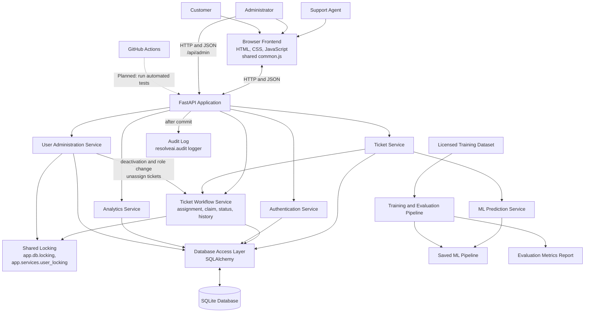

# ResolveAI — System Architecture

**Version:** 1.1
**Status:** Implemented through Phase 7 (ticket assignment and agent workflow)
**Architecture style:** Modular monolith

Sections 1 to 13 describe the overall system; section 14 covers admin user
management and section 15 the ticket assignment and agent workflow. Where
this document and the source code disagree, the source code is
authoritative.

## 1. Overview

ResolveAI is a web application for managing customer support tickets and suggesting ticket categories using machine learning.

The application will use a modular monolithic architecture. The frontend, backend API, business logic and ML prediction service will be organised into separate modules within one Python application.

The first version will run locally on Windows and use SQLite. No paid AI API or external inference service is required.

## 2. Architecture diagram



The browser will access the frontend and REST API through the FastAPI application. This same-origin arrangement keeps the initial local setup straightforward.

The ML training workflow will run separately from the web application's normal startup.

## 3. Technology stack

| Layer | Technology | Responsibility |
|---|---|---|
| Frontend | HTML, CSS, JavaScript, Bootstrap | Forms, ticket lists, filters and dashboard |
| Backend | Python and FastAPI | HTTP requests, API endpoints and validation |
| Request schemas | Pydantic | Validate API input and output |
| Database | SQLite | Store users and tickets |
| ORM | SQLAlchemy | Map Python objects to relational tables |
| ML processing | pandas and NumPy | Prepare and inspect training data |
| ML model | scikit-learn | TF-IDF text features and Logistic Regression |
| Model artifact | joblib | Save and load the trusted trained pipeline |
| Testing | pytest | Test application behaviour |
| CI | GitHub Actions | Run automated checks |
| Version control | Git and GitHub | Track and review changes |

## 4. Application modules

### 4.1 Frontend

Location: `frontend/`

The frontend is plain HTML, CSS and JavaScript with Bootstrap 5.3.8 from a
CDN, served by FastAPI from `frontend/` (no build step). It provides:

- Login screen (`index.html`)
- Role-specific dashboards (`dashboard.html`): administrator, agent
  workload and customer self-service views, with ticket creation
- Ticket list with search, filters, assignment filter and pagination, and a
  ticket details modal with editing, assignment, claiming and the activity
  timeline (`tickets.html`)
- Operations analytics and model evaluation, staff only (`analytics.html`)

All pages share `js/common.js` for authentication, requests and roles; see
[section 15.10](#1510-frontend-shared-utilities-and-role-aware-dashboards).

### 4.2 API layer

Location: `app/api/routes/`

The API layer will receive HTTP requests, validate input, invoke the appropriate service and return structured responses.

API groups:

- Authentication (`auth.py`)
- Tickets, including assignment, claiming, status changes and history
  (`tickets.py`; see [section 15](#15-ticket-assignment-and-agent-workflow))
- Analytics: summary, operations and model performance, staff only
  (`analytics.py`)
- Administration: user management, admin only (`admin.py`; see
  [section 14](#14-admin-user-management))

Interactive API documentation will be available through FastAPI's development documentation page.

### 4.3 Business services

Location: `app/services/`

The service layer will contain application rules rather than putting all logic inside API routes.

Services:

- Authentication and user access (`auth_service.py`)
- Ticket creation, search, filtering, counting and deletion
  (`ticket_service.py`)
- Ticket workflow: assignment, claiming, status changes, editing and
  history (`ticket_workflow.py`)
- Dashboard and analytics aggregation (`analytics_service.py`)
- User administration: account creation, listing, role and status changes
  (`user_service.py`)
- Shared administrator row locking (`user_locking.py`), used by user
  administration and the ticket workflow

### 4.4 Database layer

Locations: `app/db/` and `app/models/`

SQLAlchemy will manage database interactions.

The schema is versioned with Alembic migrations (`alembic/versions/`). See [database-migrations.md](database-migrations.md) for setup and upgrade procedures.

The first version will use SQLite. Database access will be separated from business logic so the project can be adapted to PostgreSQL later.

### 4.5 Machine-learning module

Location: `app/ml/`

The prediction module will load a saved scikit-learn pipeline and receive ticket text.

The pipeline will transform the text using TF-IDF and predict a ticket category using Logistic Regression.

It will return:

- Predicted category
- Model confidence estimate
- Prediction status

The module will not retrain the model when a ticket is created.

Training code and evaluation code will live separately under `ml/`.

## 5. Ticket creation workflow

1. A support agent submits a ticket from the frontend.
2. FastAPI validates the request.
3. The ticket service sends the title and description to the prediction module.
4. The prediction module returns a category suggestion and confidence estimate.
5. The ticket service stores the ticket and prediction details in SQLite.
6. The API returns the saved ticket to the frontend.
7. The frontend displays the ticket and its suggested category.
8. The support agent may correct the final category or update the priority and status.

If prediction fails, the application must still allow the ticket to be recorded. The prediction fields can remain empty, and the ticket must be marked as needing category review.

## 6. Database design

### 6.1 Users

The `users` table will contain:

- `id`: Primary key
- `name`: Display name
- `email`: Unique login identifier
- `password_hash`: Secure password hash
- `role`: Authorised application role: `admin`, `agent` or `customer`
- `is_active`: Whether the account may authenticate
- `token_version`: Session version embedded in every access token; incrementing it invalidates all previously issued tokens for the user
- `created_at`: Account creation timestamp

Passwords must never be stored in plain text.

### 6.2 Tickets

The `tickets` table will contain:

- `id`: Primary key
- `title`: Ticket title
- `description`: Ticket description
- `requester_name`: Optional requester name
- `predicted_category`: Original ML category suggestion
- `prediction_confidence`: Model confidence estimate
- `category`: Final category, which may be empty until reviewed
- `priority`: Low, Medium or High
- `status`: Open, In Progress or Resolved
- `created_by_user_id`: Foreign key referencing `users.id` (the creator)
- `created_at`: Ticket creation timestamp
- `updated_at`: Last update timestamp
- `assigned_to_user_id`: Nullable foreign key referencing `users.id` (the
  assigned agent; `NULL` while unassigned), indexed
- `assigned_at`: When the current assignment was made; `NULL` while
  unassigned
- `version`: Optimistic-concurrency counter, starting at `1`

The original prediction and final category must remain separate so human corrections do not erase the model's original output.

The application must handle tickets that have not yet received a valid prediction or final category.

### 6.3 Ticket events

The `ticket_events` table (revision `0003`) is the persistent activity
history of each ticket:

- `id`: Primary key
- `ticket_id`: Foreign key referencing `tickets.id`, `ON DELETE CASCADE`
- `event_type`: `created`, `assigned`, `reassigned`, `unassigned` or
  `status_changed`
- `actor_user_id`: Foreign key referencing `users.id` (who made the change)
- `from_assignee_id`, `to_assignee_id`: Nullable foreign keys referencing
  `users.id`
- `from_status`, `to_status`: Nullable; one of the three ticket statuses
- `reason`: Nullable; `assignee_deactivated` or `assignee_role_changed`
- `created_at`: Event timestamp (UTC)

CHECK constraints restrict every enumerated column to these values. Events
hold only IDs, fixed values and timestamps, never names, emails or ticket
text. See [section 15.3](#153-ticket-history-ticketevent).

## 7. API contract

| Method | Endpoint | Purpose |
|---|---|---|
| GET | `/api/health` | Application health check |
| POST | `/api/auth/login` | Authenticate a user |
| POST | `/api/auth/logout` | End the user session |
| GET | `/api/auth/me` | Return the current user |
| POST | `/api/tickets` | Create a ticket |
| GET | `/api/tickets` | List and filter tickets |
| GET | `/api/tickets/{id}` | Retrieve a ticket |
| PATCH | `/api/tickets/{id}` | Update ticket fields (admin, or the assigned agent) |
| DELETE | `/api/tickets/{id}` | Delete a ticket and its history (admin only) |
| GET | `/api/tickets/{id}/history` | Ticket activity history (admin and agent) |
| PUT | `/api/tickets/{id}/assignment` | Assign, reassign or unassign (admin only) |
| POST | `/api/tickets/{id}/claim` | Claim an unassigned ticket (agent only) |
| PATCH | `/api/tickets/{id}/status` | Change status (admin, or the assigned agent) |
| GET | `/api/analytics/summary` | Ticket statistics (admin and agent) |
| GET | `/api/analytics/operations` | Operational distributions and trends (admin and agent) |
| GET | `/api/analytics/model-performance` | Saved model evaluation (admin and agent) |
| GET | `/api/admin/users` | List, search and filter users (admin only) |
| GET | `/api/admin/users/{user_id}` | Retrieve a user (admin only) |
| POST | `/api/admin/users` | Create a user (admin only) |
| PATCH | `/api/admin/users/{user_id}/role` | Change a user's role (admin only) |
| PATCH | `/api/admin/users/{user_id}/status` | Activate or deactivate a user (admin only) |

All protected endpoints enforce authentication and role-based access.
Ticket creation, listing and retrieval are open to every role; customers
only see their own tickets.

The admin user-management contract is documented in the
[README](../README.md#admin-user-management); the ticket workflow contract
in [section 15.6](#156-workflow-api) and the
[README](../README.md#ticket-assignment-and-agent-workflow).

## 8. Machine-learning workflow

The model-development workflow will be separate from the web application.

1. Obtain the documented customer-service dataset.
2. Inspect the dataset structure, category labels and licence.
3. Clean and validate the text and labels.
4. Define and document the mapping from source labels to ResolveAI categories.
5. Split the data into training, validation and test sets.
6. Train a TF-IDF and Logistic Regression baseline.
7. Evaluate the model using accuracy, macro-F1, precision, recall and a confusion matrix.
8. Save the approved pipeline and evaluation report.
9. Load the saved pipeline in the application.
10. Record predictions and allow support agents to correct them.

Test data must not be used to train the model or select its settings.

Reported metrics must come from actual evaluation results. Confidence estimates must not be presented as guarantees of correctness.

## 9. Error handling and security

- Validate required input fields and supported status, priority and category values.
- Return understandable HTTP error responses for invalid requests.
- Handle prediction failures without losing the ticket.
- Store password hashes, never plain-text passwords.
- Keep secret keys and local configuration out of source control.
- Enforce authentication on protected API routes.
- Apply appropriate authorisation checks to ticket operations.
- Avoid logging passwords, secret tokens or unnecessary personal information.
- Use only trusted model artifacts created by the project's training workflow.
- Use production security settings before any public deployment.
- Return `401` when authentication fails and `403` when an authenticated user's role is not permitted; decide authorisation before validating request bodies.
- Never return password hashes or `token_version` in API responses, and never echo submitted values in validation errors on the admin API.
- Record administrative actions with IDs, action names and role/status values only (see [section 14.6](#146-audit-logging)).

## 10. Testing strategy

Automated tests will cover:

- Application health checks
- Request validation
- Ticket creation and retrieval
- Ticket updates and category correction
- Database behaviour
- Authentication and access control
- Search and filtering
- Analytics calculations
- Prediction service behaviour
- Error handling when the model is unavailable
- Ticket assignment, claiming, status transitions, history and their
  concurrency (see [section 15.12](#1512-tests))
- Migrations, including upgrade and downgrade of every revision

The suite runs locally with `python -m pytest`. A GitHub Actions workflow
is planned but not yet configured in the repository (there is no
`.github/workflows/`).

## 11. Repository structure

The README's [Project Architecture](../README.md#project-architecture)
section lists every file. In outline:

```text
resolveai-support-ticket-system/
├── app/
│   ├── main.py                 # FastAPI app, routers, static frontend
│   ├── api/
│   │   ├── dependencies.py     # authentication and role dependencies
│   │   └── routes/             # auth, tickets, analytics, admin
│   ├── core/                   # config, roles, security, audit logging
│   ├── db/                     # engine, migrations helpers, locking
│   ├── models/                 # User, Ticket, TicketEvent, RevokedToken
│   ├── schemas/                # Pydantic request/response models
│   ├── services/               # auth, tickets, workflow, users, analytics
│   ├── scripts/                # create_admin, create_agent, reset password
│   └── ml/predictor.py
├── alembic/versions/           # 0001, 0002, 0003
├── frontend/                   # index, dashboard, tickets, analytics
│   ├── css/
│   └── js/                     # common.js + one script per page
├── ml/                         # dataset preparation, training, evaluation
├── tests/
├── docs/
│   ├── architecture.md
│   ├── database-migrations.md
│   └── requirements.md
├── .env.example
├── alembic.ini
├── README.md
└── requirements.txt
```

Local datasets, database files, secrets, virtual environments and other
generated files are excluded from Git.

## 12. Development and deployment

Local development will be the primary environment.

The first version will use SQLite and a CPU-compatible model, without requiring a paid API or cloud account.

Deployment will be considered only after the application, tests and documentation are working locally. Any external hosting option will be evaluated against its current free-tier limits and security requirements.

## 13. Architecture decisions to validate

Before implementation is complete, we must verify:

- The training dataset's licence and permitted uses.
- The actual source labels and the final category mapping.
- Compatibility between the chosen Python version and package versions.
- The authentication and session strategy.
- Database migration requirements. (Resolved: Alembic, with a baseline revision for pre-existing databases.)
- How the trained model and evaluation report will be generated from a fresh clone.
- The security configuration required for any public deployment.
- Concurrency of protected admin changes on PostgreSQL. Row locking is implemented but has only been checked by compiling the SQL, not under concurrent load on a live PostgreSQL server (see [section 14.4](#144-postgresql-and-other-databases)).
- Concurrency of the ticket workflow on PostgreSQL, for the same reason (see [section 15.11](#1511-sqlite-locking-strategy-and-postgresql-limitations)).
- Whether a persistent, database-backed audit trail is required in addition to the audit log stream. (Ticket history is persistent; administrative and ticket audit records are a log stream only.)

## 14. Admin user management

Administrators manage accounts through the admin-only API in
`app/api/routes/admin.py` (mounted at `/api/admin`). The route module maps
service outcomes to HTTP responses and writes the audit log. The rules and
transactions live in `app/services/user_service.py`. The HTTP contract
(parameters, bodies, status codes, examples) is documented in the
[README](../README.md#admin-user-management).

### 14.1 Roles and request authorisation

The three roles are defined in `app/core/roles.py` (`UserRole`): `admin`,
`agent` and `customer`.

1. `get_current_user` (`app/api/dependencies.py`) decodes the JWT and loads
   the user from the database. A missing or invalid token, a revoked token,
   an inactive account or a `token_version` that differs from the stored one
   gives `401`.
2. `require_admin` (`require_roles(UserRole.ADMIN)`) gives `403` unless the
   stored role is exactly `admin`. Unknown stored roles are denied.
3. The admin router declares `require_admin` as a router-wide dependency, and
   each endpoint declares it as well (FastAPI evaluates it once per request).
   Dependencies run before body validation, so non-administrators receive
   `403`, never `422`.

The role is never read from the token; it is loaded from the database on
every request. This is why a role change takes effect immediately for tokens
the user already holds, without incrementing `token_version`.

### 14.2 Session invalidation

A status change (deactivation **or** reactivation) writes `is_active` and then
increments `token_version` with an atomic SQL `UPDATE`
(`invalidate_user_sessions(commit=False)`). Both changes are committed
together, so every token issued before the change is rejected afterwards, and
tokens issued before a deactivation never become valid again after
reactivation. Requesting the status the account already has writes nothing
and does not increment `token_version`.

Users are not deleted through the API. Deactivation keeps rows that reference
the user (for example `tickets.created_by_user_id`) intact, and it can be
reversed.

### 14.3 Serialised protected changes (SQLite)

Three operations are protected: account creation, role change and status
change. Each must check, inside one transaction that no other protected
change can interleave with:

- that the change does not remove the last **active** administrator (role
  `admin` and `is_active` true), for role and status changes;
- that the acting administrator is still an active administrator (actor
  revalidation). The request was authorised before the transaction started,
  and a concurrent request may have demoted or deactivated the actor since
  then.

Counting and then updating separately is not enough. Two administrators
deactivating each other at the same moment could each see two active
administrators and both succeed.

On SQLite, `SELECT ... FOR UPDATE` is not available, and the pysqlite driver
does not open a transaction until the first write. Each protected change
therefore begins with `BEGIN IMMEDIATE` (`_begin_serialised_change`), which
takes SQLite's single write lock **before** anything is read. The transaction
then:

1. reads the IDs of the active administrators, then reloads the target row
   (or, for creation, the actor's row), overwriting any stale copy loaded
   during authorisation;
2. applies the checks;
3. writes and commits, or rolls back on any failure. The commit also happens
   for a no-op, to release the lock.

A concurrent protected change waits for the lock up to the connection's
busy timeout. The application does not set one, so the Python `sqlite3`
default of 5 seconds applies. If the lock is not released in time, the change
fails with a safe `500` and writes nothing. A protected change refuses to run
in a session that has already written in its current transaction
(`TransactionAlreadyStartedError`), because `BEGIN IMMEDIATE` cannot be
issued there. That is a programming error, never a client error.

The self-modification check (`409`) happens before the transaction starts,
because it needs no database state.

**Account creation** (`create_user_as_admin`) performs actor revalidation,
insertion and commit in the same protected transaction:

1. `BEGIN IMMEDIATE`; reload the actor's row. The actor must exist, be active
   and have exactly the role `admin`, otherwise `403` and nothing is written.
2. `create_user(..., commit=False)` validates and normalises the fields,
   checks for a duplicate email (case-insensitive), hashes the password and
   inserts the row.
3. Commit.

**Trade-off: password hashing under the write lock.** Step 2 hashes the
password while the SQLite write lock is held, so other writes (including
other protected changes) wait for the duration of one hash. This is
intentional: it keeps revalidation and insertion atomic, so an administrator
whose access is removed concurrently cannot still create an account. The
password length (12 to 128 characters) is validated before the request
reaches the service, which bounds the hashing cost.

### 14.4 PostgreSQL and other databases

On databases with row locks, no `BEGIN IMMEDIATE` is issued. Instead the reads
in step 1 use `SELECT ... FOR UPDATE`: first every active administrator row,
in `id` order so that two changes cannot deadlock, then the target or actor
row. A concurrent change blocks until the first commits and then re-reads the
locked rows.

**Status:** this has been verified only by checking the compiled SQL for the
PostgreSQL dialect. Concurrency has **not** been tested against a live
PostgreSQL server, and PostgreSQL is not yet a supported production database.
In addition, recognising a duplicate email from the database's unique index
(the case where two requests create the same email at the same moment) is
implemented for SQLite's error only. Duplicates that already exist are found
by a lookup before the insert on any database.

### 14.5 Error handling

- Expected outcomes map to fixed messages: `404` (user not found), `409`
  (duplicate email, self-modification, last active administrator), `403`
  (actor no longer an administrator).
- The admin routes use a route class (`AdminRoute`) that removes submitted
  values (`input`) from `422` validation errors, so passwords and smuggled
  fields such as `password_hash` are never echoed back. The request models
  also forbid extra fields.
- Unexpected database errors reach the application's `SQLAlchemyError`
  handler: the client receives `500 {"detail": "Internal server error."}`
  and the server logs a short sanitised diagnostic without SQL, parameters or
  a traceback. If a rollback also fails, the original error is reported and
  the rollback failure is attached as a secondary failure.

### 14.6 Audit logging

`app/core/audit_logging.py` provides the dedicated `resolveai.audit` logger
and the fixed-field record helpers (`log_admin_action` and, for tickets, the
helpers described in [section 15.9](#159-ticket-audit-logging)).
`log_admin_action` remains importable from `app.api.routes.admin`.
The route module calls `log_admin_action` only after the change has committed,
and only when something actually changed. Records contain the action
(`user.create`, `user.role_change`, `user.activate`, `user.deactivate`),
`actor_id`, `target_user_id` and the safe before/after role or status values.
Since Phase 7, `user.deactivate` and `user.role_change` also carry
`unassigned_tickets`, the number of tickets unassigned by the change
(section 15.7).
They never contain passwords, hashes, JWTs, names, emails or request bodies.

`configure_audit_logging()` runs when `app.main` is imported, at every
start-up and before every record, so the router also logs correctly if it is
mounted in an application that never imports `app.main`. It is idempotent,
thread-safe and respects operator configuration:

- it re-enables the logger if a configuration disabled it;
- it sets the level to `INFO` only while the level is unset;
- only when the logger has **no** handlers does it add the default handler
  (standard error, `UtcIsoFormatter`, UTC ISO-8601 timestamps) and set
  `propagate` to `false`;
- it never removes or changes operator handlers or `propagate`.

Public helpers: `AUDIT_LOGGER_NAME`, `AUDIT_LOG_FORMAT`, `UtcIsoFormatter`,
`get_audit_logger()`, `configure_audit_logging()` and
`is_default_audit_handler()`. Operator configuration examples (own handler,
`NullHandler` with `propagate: true` for root-only routing, and the need to
state `propagate` explicitly when reconfiguring after import) are in the
[README](../README.md#configuring-the-audit-logger).

The audit log is a log stream, **not** a persistent database audit trail.
Records are emitted after the commit and are not stored in the database.

### 14.7 Tests

- `tests/test_admin_users_api.py`: authentication and authorisation (`401`
  and `403`), pagination, search and filters, validation, duplicate emails,
  role and status semantics, administrator safeguards, concurrent changes on
  a temporary SQLite file (including the same race without the lock, which
  shows that the lock is needed), lock time-outs, rollback failures and audit
  records.
- `tests/test_audit_logging.py`: default output, timestamps, idempotence,
  thread safety, operator handlers, levels and propagation, and real
  `dictConfig` configurations applied in fresh interpreters before and after
  import.

## 15. Ticket assignment and agent workflow

Phase 7 adds ticket ownership by agents, an agent claim workflow, status
transition rules, a persistent ticket history and role-aware frontend
pages. The rules and transactions live in
`app/services/ticket_workflow.py`; the HTTP contract in
`app/api/routes/tickets.py`; the schema in revision `0003`
([database-migrations.md](database-migrations.md#8-upgrading-an-existing-database-to-0003)).

### 15.1 Creator and assignee

A ticket references `users` twice:

| Column | Relationship | Meaning |
|---|---|---|
| `created_by_user_id` | `Ticket.creator` / `User.tickets` | Who created the ticket. Never changes. Scopes customer access. |
| `assigned_to_user_id` | `Ticket.assignee` / `User.assigned_tickets` | The agent currently responsible; `NULL` while unassigned. `assigned_at` records when. |

Only users whose stored role is exactly `agent` and who are active can be
assignees (`ASSIGNABLE_ROLES`). Administrators manage tickets but are never
assignees. The database enforces only the foreign key; the role and
activity rules are enforced by the workflow service, inside its
transaction.

### 15.2 Versioning and optimistic concurrency

`tickets.version` is SQLAlchemy's `version_id_col`. Every ORM `UPDATE` or
`DELETE` of a ticket includes `WHERE version = <loaded version>` and
increments it, so two writers cannot silently overwrite each other: the
stale one fails with `StaleDataError`.

Two layers use it:

1. **Explicit check.** The assignment, claim and status endpoints require
   `expected_version` (a strict JSON integer); `PATCH /api/tickets/{id}`
   accepts it optionally. Inside the locked transaction the service
   compares it with the stored version and raises
   `TicketVersionConflictError` if they differ. The frontend always sends
   the version it last read.
2. **ORM check.** A stale write that slips past (for example a delete
   racing a change) raises `StaleDataError`.

The ticket router (`TicketRoute`) maps both to `409` with
`"The ticket was changed by someone else. Reload and try again."`; nothing
is written. A no-op (the same assignee or status) writes nothing and does
not change the version.

### 15.3 Ticket history (TicketEvent)

`app/models/ticket_event.py` (table in [section 6.3](#63-ticket-events))
records one row per real change, in the **same transaction** as the change,
so a change and its history are committed or rolled back together.

| Event | Written by | Fields |
|---|---|---|
| `created` | Ticket creation (`ticket_service.create_ticket`) | actor = creator |
| `assigned` | Assignment of an unassigned ticket, or a claim (actor = assignee) | `to_assignee_id` |
| `reassigned` | Assignment from one agent to another | `from_assignee_id`, `to_assignee_id` |
| `unassigned` | Unassignment by an administrator, or automatically (section 15.7, with `reason`) | `from_assignee_id`; `from_status`/`to_status` when "In Progress" returned to "Open" |
| `status_changed` | A real status change through `PATCH` or `/status` | `from_status`, `to_status` |

`record_ticket_event` validates every value against the approved sets
before adding the row, never commits, and never stores names, emails or
ticket text. Deleting a ticket deletes its history (`ON DELETE CASCADE`);
the `ticket.delete` audit record (section 15.9) then remains. Tickets that
existed before revision `0003` have no events.

### 15.4 Workflow service and rules

`app/services/ticket_workflow.py` owns every ticket change except creation
and deletion:

| Operation | Who | Rules |
|---|---|---|
| `assign_ticket` | Active administrator | Assign, reassign or unassign (`None`). The assignee must be an active `agent`. Unassigning an "In Progress" ticket returns it to "Open". |
| `claim_ticket` | Active agent | The ticket must be unassigned and "Open" or "In Progress"; it is assigned to the caller. Resolved tickets cannot be claimed. |
| `change_ticket_status` | Active administrator, or the assigned agent | Follows `STATUS_TRANSITIONS`. |
| `edit_ticket` | Active administrator, or the assigned agent | Title, description, requester name, category, priority and status (`EDITABLE_FIELDS`); a status change follows the same rules. Assignment, version, creator and AI fields cannot be edited. |

Permitted status transitions (`STATUS_TRANSITIONS`):

| From | To | Requires an assignee |
|---|---|---|
| Open | In Progress | Yes |
| Open | Resolved | Yes |
| In Progress | Open | No |
| In Progress | Resolved | No |
| Resolved | In Progress | Yes |

Anything else, including Resolved to Open, is rejected. Repeating the
current status is a no-op. `can_manage_ticket` decides management rights:
active administrators manage every ticket, active agents only tickets
assigned to them, customers none.

Each operation follows the same pattern (`_run_change`): take the lock and
read everything inside it (section 15.5), re-validate the actor, check the
ticket, the version and the rule, write the change and its event, and
commit. On **any** failure it rolls back and re-raises the original error;
a failed rollback is attached as a secondary failure. Errors carry fixed
messages only.

The `*_with_result` variants return what changed, captured before the
commit, so the API writes its audit record without reading the database
again.

### 15.5 Shared database locking

Two modules, shared by user administration and the ticket workflow:

- `app/db/locking.py`: `begin_serialised_change(db)` starts the write
  transaction. On SQLite it issues `BEGIN IMMEDIATE` before anything is
  read; on other databases it does nothing and the following reads take
  row locks. It refuses a session that has already written
  (`TransactionAlreadyStartedError`, a programming error). It never
  commits or rolls back.
- `app/services/user_locking.py`: `lock_active_administrator_ids(db)`
  reads (and, where supported, locks with `FOR UPDATE`) the active
  administrator rows in `id` order.

Every protected change locks rows in **one global order**:

1. the active administrator rows, ascending `id` (user administration and
   ticket assignment);
2. the other user row involved (target, assignee or actor);
3. ticket rows, ascending `id`.

On databases with row locks this order prevents deadlocks between user
administration and ticket changes. Every locked read uses
`populate_existing`, so values loaded earlier in the request (for example
during authorisation) are replaced by the locked ones.

### 15.6 Workflow API

| Method | Endpoint | Role | Body |
|---|---|---|---|
| PUT | `/api/tickets/{id}/assignment` | admin | `{"assigned_to_user_id": <agent id or null>, "expected_version": <int>}`; both required, `null` unassigns |
| POST | `/api/tickets/{id}/claim` | agent | `{"expected_version": <int>}` |
| PATCH | `/api/tickets/{id}/status` | admin, agent | `{"status": "...", "expected_version": <int>}` |
| PATCH | `/api/tickets/{id}` | admin, agent | changed fields, optional `expected_version` |
| GET | `/api/tickets/{id}/history` | admin, agent | |

Each returns the staff view of the ticket (`StaffTicketRead`), the history
endpoint a list of `TicketEventRead`. Request bodies forbid extra fields.
Role checks run before body validation (`403`, never `422`, for the wrong
role).

| Status | Meaning |
|---|---|
| `403` | Wrong role, the actor lost access before the change, or an agent acting on a ticket that is not theirs |
| `404` | Ticket not found |
| `409` | Version conflict; `Ticket is already assigned.`; `Resolved tickets cannot be claimed.`; a forbidden status transition or one that needs an assignee |
| `422` | Invalid body; `Assignee must be an active agent.` |
| `500` | Unexpected error (fixed `Internal server error.`) |

### 15.7 User deactivation and role changes unassign tickets

When an account is deactivated (`set_user_active_status`), or an agent's
role changes to one that cannot hold tickets (`change_user_role`),
`unassign_open_tickets_for_user` runs **inside the same serialised
transaction** as the user change:

- every "Open" ticket assigned to the user is unassigned and stays "Open";
- every "In Progress" ticket is unassigned and returns to "Open";
- "Resolved" tickets keep their assignee;
- each changed ticket gets one `unassigned` event with the reason
  (`assignee_deactivated` or `assignee_role_changed`) and its version is
  incremented.

The user change, the ticket changes, their events and (for status
changes) the `token_version` increment are committed together or not at
all. Ticket rows are locked after the user rows, following the global
order. Reactivation does not restore earlier assignments. The admin audit
record carries the number of unassigned tickets.

### 15.8 Agent workload and customer privacy

`GET /api/tickets` supports, for staff only, `assigned_to=me` (the
caller's tickets), `assigned_to=none` (unassigned) or a user ID. A customer
sending `assigned_to` receives `422`. Every list response carries
`X-Total-Count`, the number of tickets matching all filters before
`skip`/`limit`; the list and the count share one definition of the filters
(`_ticket_conditions`). Tickets are ordered newest first
(`created_at`, then `id`, descending).

Responses are role-specific:

- **Staff** receive `StaffTicketRead`: `is_assigned`,
  `assigned_to_user_id`, `assignee` (`id` and `name` only), `assigned_at`
  and `version`.
- **Customers** receive `CustomerTicketRead`: whether the ticket is
  assigned (`is_assigned`), never who. Customers only list and retrieve
  tickets they created; another user's ticket gives the same `404` as a
  missing one. They cannot read history, assign, claim, edit, change status
  or delete.
- History events contain user IDs only, no names.

### 15.9 Ticket audit logging

After each committed change the ticket routes write a `ticket_action`
record through `resolveai.audit` (`app/core/audit_logging.py`):

| Action | When | Fields |
|---|---|---|
| `ticket.assign` | A real assignment, reassignment or unassignment | `event_type`, `previous_assignee_id`, `new_assignee_id` |
| `ticket.claim` | A claim | `assignee_id` |
| `ticket.status_change` | A real status change through `PATCH` or `/status` | `status_before`, `status_after` |
| `ticket.delete` | A deletion | (the only record left: history is deleted with the ticket) |

Every record has `action`, `actor_id` and `ticket_id`. Values are IDs and
allowlisted statuses or event types only (anything else is logged as
`unrecognised`); never titles, descriptions, names, emails or tokens.
No-ops and rejected requests are not logged. Ticket creation is recorded in
the ticket history, not the audit log. The "In Progress" to "Open" change
implied by an unassignment appears in the ticket history but not as a
separate `ticket.status_change` record.

### 15.10 Frontend shared utilities and role-aware dashboards

`frontend/js/common.js` is loaded before every page script and exposes one
frozen global, `window.ResolveAI`:

- token storage (`sessionStorage` key `resolveai_access_token`),
  `authenticatedFetch` (bearer token; `401` clears the session and
  redirects to the login page; `403` is returned to the caller and never
  logs out), `safeFetch` (readable network errors) and `apiRequest`;
- safe error parsing (`checkApiResponse`, `getApiErrorMessage`): only the
  API's `detail` text, capped in length, never echoed input;
- `loadCurrentUser()`: one `/api/auth/me` request per page load, shared by
  every caller;
- role helpers (`isAdmin`, `isAgent`, `isCustomer`, `isStaff`) and
  `applyRoleVisibility`: elements marked `data-visible-roles` start hidden
  and are shown only once the role is confirmed, so nothing privileged
  appears if the profile cannot be loaded;
- `logout` and `bindLogoutButton`.

Pages render every server value with `textContent` or DOM construction.

- **Dashboard** (`dashboard.js`). Administrator: the global statistics
  (`/api/analytics/summary`), an Unassigned card, quick links and the five
  newest tickets with their assignee. Agent: My Open, My In Progress and My
  Assigned (all statuses) counts, the unassigned queue and the tickets most
  recently assigned to them. Customer: totals per status, recent requests
  and self-service ticket creation; no staff endpoints are called. Counts
  use `limit=1` and read `X-Total-Count`. Each section has its own loading,
  empty, error and Retry states.
- **Tickets** (`tickets.js`). Assigned column (agent name for staff, a
  neutral label for customers), assignment filter (administrators: All /
  Unassigned; agents: All / Assigned to Me / Unassigned; customers: none),
  pagination from `X-Total-Count`, and a details modal whose controls are
  removed for roles that may not use them: assignment (administrator),
  claim (agent, eligible tickets), edit (administrator, or the assigned
  agent), delete (administrator) and the activity timeline (staff). Edits
  send only changed fields with `expected_version`; a `409` keeps the
  form's values and offers **Reload Ticket**, never retrying automatically.
  The page accepts `?status=`, `?assigned_to=` and `?ticket=` for links
  from the dashboard, applied only when the role can use them.

The UI only offers permitted actions; the API remains the authority for
every permission.

### 15.11 SQLite locking strategy and PostgreSQL limitations

On SQLite, every workflow change starts with `BEGIN IMMEDIATE`, so it holds
the single database write lock from its first read to its commit. Changes
are therefore fully serialised with each other and with protected user
administration: no two can interleave their reads and writes. A waiting
change blocks up to the connection's busy timeout (the Python `sqlite3`
default of 5 seconds; the application does not change it) and then fails
with a safe `500`, writing nothing. Ticket creation and deletion are not
serialised this way; deletion relies on the version check (`409`).

On PostgreSQL and other databases with row locks, no `BEGIN IMMEDIATE` is
issued; the reads use `SELECT ... FOR UPDATE` in the global order of
section 15.5. **This has been verified only by compiling the SQL.** The
workflow has not been run against a live PostgreSQL server, and PostgreSQL
is not a supported production database. The migrations are also written
and tested for SQLite only.

### 15.12 Tests

- `tests/test_ticket_workflow.py`: rules, transitions, permissions,
  events, version conflicts, rollback on failure, and concurrency on a
  temporary SQLite file.
- `tests/test_ticket_workflow_api.py`: assignment, claim and status
  endpoints, filters, `X-Total-Count`, customer privacy and stale writes.
- `tests/test_ticket_history_api.py`: the history endpoint.
- `tests/test_ticket_models.py`: relationships, cascade and versioning.
- `tests/test_user_ticket_concurrency.py`: user administration and ticket
  changes racing each other on a temporary SQLite file.
- `tests/test_db_locking.py`: the shared serialised-transaction helper.
- `tests/test_migrations.py`: revision `0003` upgrade, downgrade, data
  preservation, constraints, and refusal on unexpected columns.

All tests use in-memory or temporary databases and never touch
`resolveai.db`.
