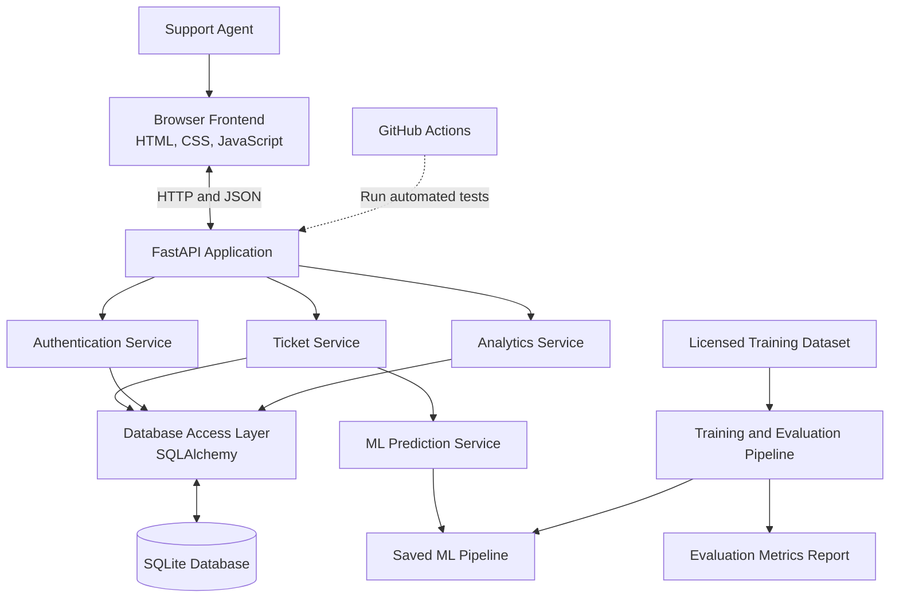

# ResolveAI — System Architecture

**Version:** 1.0
**Status:** Initial architecture
**Architecture style:** Modular monolith

## 1. Overview

ResolveAI is a web application for managing customer support tickets and suggesting ticket categories using machine learning.

The application will use a modular monolithic architecture. The frontend, backend API, business logic and ML prediction service will be organised into separate modules within one Python application.

The first version will run locally on Windows and use SQLite. No paid AI API or external inference service is required.

## 2. Architecture diagram



The browser will access the frontend and REST API through the FastAPI application. This same-origin arrangement keeps the initial local setup straightforward.

The ML training workflow will run separately from the web application's normal startup.

## 3. Technology stack

| Layer | Technology | Responsibility |
|---|---|---|
| Frontend | HTML, CSS, JavaScript, Bootstrap | Forms, ticket lists, filters and dashboard |
| Backend | Python and FastAPI | HTTP requests, API endpoints and validation |
| Request schemas | Pydantic | Validate API input and output |
| Database | SQLite | Store users and tickets |
| ORM | SQLAlchemy | Map Python objects to relational tables |
| ML processing | pandas and NumPy | Prepare and inspect training data |
| ML model | scikit-learn | TF-IDF text features and Logistic Regression |
| Model artifact | joblib | Save and load the trusted trained pipeline |
| Testing | pytest | Test application behaviour |
| CI | GitHub Actions | Run automated checks |
| Version control | Git and GitHub | Track and review changes |

## 4. Application modules

### 4.1 Frontend

Location: `frontend/`

The frontend will provide:

- Login screen
- Ticket dashboard
- Ticket creation form
- Ticket list with search and filters
- Ticket detail and edit view
- ML prediction and confidence display
- Model evaluation summary

JavaScript will call the backend using HTTP requests and process JSON responses.

### 4.2 API layer

Location: `app/api/routes/`

The API layer will receive HTTP requests, validate input, invoke the appropriate service and return structured responses.

Planned API groups:

- Authentication
- Tickets
- Analytics
- ML predictions and evaluation metrics

Interactive API documentation will be available through FastAPI's development documentation page.

### 4.3 Business services

Location: `app/services/`

The service layer will contain application rules rather than putting all logic inside API routes.

Planned services:

- Authentication and user access
- Ticket creation and updates
- Ticket search and filtering
- Dashboard aggregation

### 4.4 Database layer

Locations: `app/db/` and `app/models/`

SQLAlchemy will manage database interactions.

The first version will use SQLite. Database access will be separated from business logic so the project can be adapted to PostgreSQL later.

### 4.5 Machine-learning module

Location: `app/ml/`

The prediction module will load a saved scikit-learn pipeline and receive ticket text.

The pipeline will transform the text using TF-IDF and predict a ticket category using Logistic Regression.

It will return:

- Predicted category
- Model confidence estimate
- Prediction status

The module will not retrain the model when a ticket is created.

Training code and evaluation code will live separately under `ml/`.

## 5. Ticket creation workflow

1. A support agent submits a ticket from the frontend.
2. FastAPI validates the request.
3. The ticket service sends the title and description to the prediction module.
4. The prediction module returns a category suggestion and confidence estimate.
5. The ticket service stores the ticket and prediction details in SQLite.
6. The API returns the saved ticket to the frontend.
7. The frontend displays the ticket and its suggested category.
8. The support agent may correct the final category or update the priority and status.

If prediction fails, the application must still allow the ticket to be recorded. The prediction fields can remain empty, and the ticket must be marked as needing category review.

## 6. Database design

### 6.1 Users

The `users` table will contain:

- `id`: Primary key
- `name`: Display name
- `email`: Unique login identifier
- `password_hash`: Secure password hash
- `role`: Authorised application role
- `created_at`: Account creation timestamp

Passwords must never be stored in plain text.

### 6.2 Tickets

The `tickets` table will contain:

- `id`: Primary key
- `title`: Ticket title
- `description`: Ticket description
- `requester_name`: Optional requester name
- `predicted_category`: Original ML category suggestion
- `prediction_confidence`: Model confidence estimate
- `category`: Final category, which may be empty until reviewed
- `priority`: Low, Medium or High
- `status`: Open, In Progress or Resolved
- `created_by_user_id`: Foreign key referencing `users.id`
- `created_at`: Ticket creation timestamp
- `updated_at`: Last update timestamp

The original prediction and final category must remain separate so human corrections do not erase the model's original output.

The application must handle tickets that have not yet received a valid prediction or final category.

## 7. API contract

| Method | Endpoint | Purpose |
|---|---|---|
| GET | `/api/health` | Application health check |
| POST | `/api/auth/login` | Authenticate a user |
| POST | `/api/auth/logout` | End the user session |
| GET | `/api/auth/me` | Return the current user |
| POST | `/api/tickets` | Create a ticket |
| GET | `/api/tickets` | List and filter tickets |
| GET | `/api/tickets/{id}` | Retrieve a ticket |
| PATCH | `/api/tickets/{id}` | Update ticket fields |
| GET | `/api/analytics/summary` | Retrieve dashboard statistics |
| POST | `/api/ml/predict` | Test an ML prediction |
| GET | `/api/ml/metrics` | Retrieve the saved evaluation report |

All protected endpoints must enforce authentication and appropriate access permissions.

The final request and response schemas will be specified during implementation.

## 8. Machine-learning workflow

The model-development workflow will be separate from the web application.

1. Obtain the documented customer-service dataset.
2. Inspect the dataset structure, category labels and licence.
3. Clean and validate the text and labels.
4. Define and document the mapping from source labels to ResolveAI categories.
5. Split the data into training, validation and test sets.
6. Train a TF-IDF and Logistic Regression baseline.
7. Evaluate the model using accuracy, macro-F1, precision, recall and a confusion matrix.
8. Save the approved pipeline and evaluation report.
9. Load the saved pipeline in the application.
10. Record predictions and allow support agents to correct them.

Test data must not be used to train the model or select its settings.

Reported metrics must come from actual evaluation results. Confidence estimates must not be presented as guarantees of correctness.

## 9. Error handling and security

- Validate required input fields and supported status, priority and category values.
- Return understandable HTTP error responses for invalid requests.
- Handle prediction failures without losing the ticket.
- Store password hashes, never plain-text passwords.
- Keep secret keys and local configuration out of source control.
- Enforce authentication on protected API routes.
- Apply appropriate authorisation checks to ticket operations.
- Avoid logging passwords, secret tokens or unnecessary personal information.
- Use only trusted model artifacts created by the project's training workflow.
- Use production security settings before any public deployment.

## 10. Testing strategy

Automated tests will cover:

- Application health checks
- Request validation
- Ticket creation and retrieval
- Ticket updates and category correction
- Database behaviour
- Authentication and access control
- Search and filtering
- Analytics calculations
- Prediction service behaviour
- Error handling when the model is unavailable

The same automated test suite should run locally and through GitHub Actions.

## 11. Repository structure

```text
resolveai-support-ticket-system/
├── app/
│   ├── main.py
│   ├── api/
│   │   └── routes/
│   ├── core/
│   ├── db/
│   ├── models/
│   ├── schemas/
│   ├── services/
│   └── ml/
│       └── predictor.py
├── frontend/
│   ├── index.html
│   ├── tickets.html
│   ├── ticket-detail.html
│   ├── css/
│   └── js/
├── ml/
│   ├── train.py
│   └── evaluate.py
├── tests/
├── docs/
│   ├── requirements.md
│   └── architecture.md
├── .github/
│   └── workflows/
├── .env.example
├── .gitignore
├── README.md
└── requirements.txt
```

The directory structure will be introduced progressively. Local datasets, database files, secrets, virtual environments and other generated files will be excluded from Git as appropriate.

## 12. Development and deployment

Local development will be the primary environment.

The first version will use SQLite and a CPU-compatible model, without requiring a paid API or cloud account.

Deployment will be considered only after the application, tests and documentation are working locally. Any external hosting option will be evaluated against its current free-tier limits and security requirements.

## 13. Architecture decisions to validate

Before implementation is complete, we must verify:

- The training dataset's licence and permitted uses.
- The actual source labels and the final category mapping.
- Compatibility between the chosen Python version and package versions.
- The authentication and session strategy.
- Database migration requirements.
- How the trained model and evaluation report will be generated from a fresh clone.
- The security configuration required for any public deployment.
